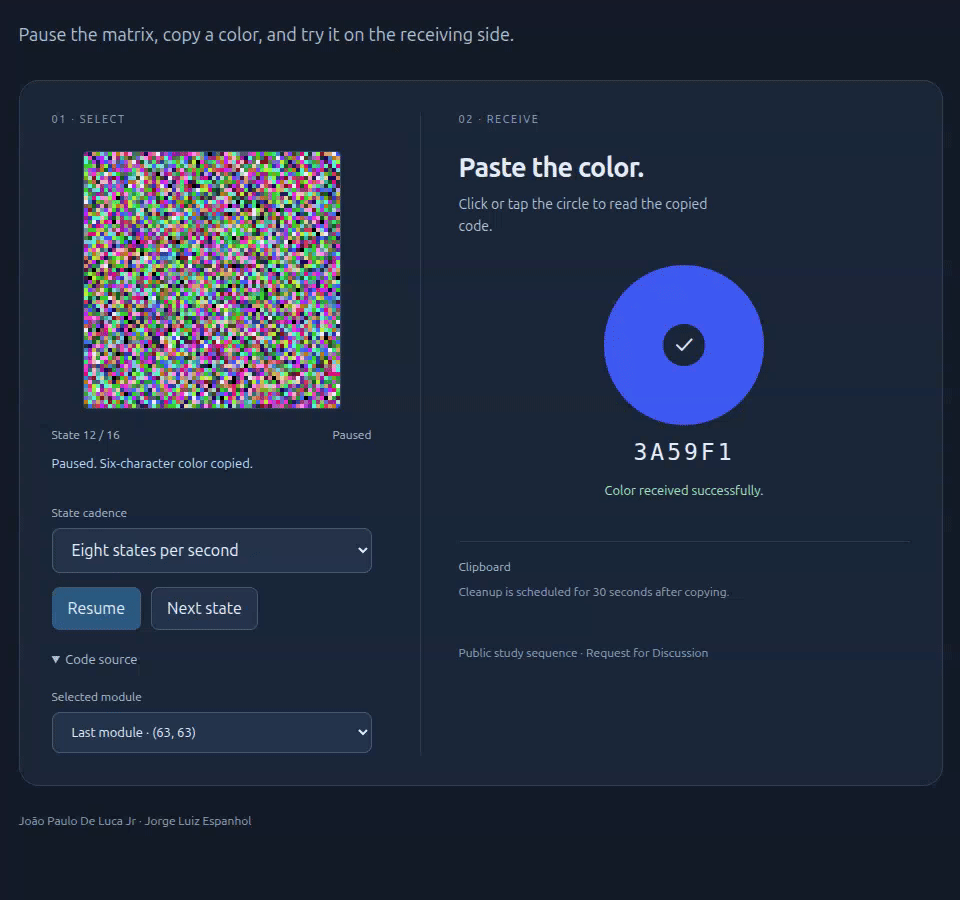

<!--
SPDX-FileCopyrightText: 2026 Cecil-IA Labs
SPDX-License-Identifier: MIT

Author: João Paulo De Luca Jr.; Jorge Luiz Espanhol
Organization: Cecil-IA Labs
Project: Quad-Dimensional DataMatrix

AI-assisted development:
OpenAI ChatGPT and Codex were used as development tools.
Human-directed development and integration.
No OpenAI sponsorship, affiliation, or endorsement is implied.

License: See the repository LICENSE file and SPDX identifier above.
-->

# Quad-Dimensional DataMatrix

**Request for Discussion (RfD), version 0.2.0.**

**João Paulo De Luca Jr · Jorge Luiz Espanhol**

Cecil-IA Labs · 4 November 2026

[Archived version 0.2.0 on Zenodo](https://doi.org/10.5281/zenodo.23968974) · [All-version DOI](https://doi.org/10.5281/zenodo.23968973)

[Português](README.pt.md) · [English paper](paper/quad-dimensional-datamatrix.en.pdf) · [Portuguese paper](paper/quad-dimensional-datamatrix.pt.pdf) · [Zenodo preparation](docs/publication.md)

Quad-Dimensional DataMatrix explores a catalogue with four logical coordinates: horizontal position, vertical position, temporal state, and hexadecimal dimension. An indexed GIF carries the corresponding sequence. English is the default language; Portuguese is the alternative.

## Concept demonstration



[Watch or download WebM](docs/media/quad-dimensional-datamatrix-poc.webm) · [Media notes and reproduction](docs/media/README.md)

The recording shows the bilingual local app: advancing states, pausing and copying a selected color, then receiving it in the circle. Its 960 × 900 presentation GIF and WebM are recorded views of the interface. The data-bearing example is the separate [16-state indexed GIF](examples/quad-dimensional-datamatrix-16-states.gif); the two animations have different roles and palettes.

## Working profile

| Property | Current discussion profile |
|---|---|
| Container | Indexed GIF |
| Stored frame | 256 × 256 pixels |
| Effective matrix | 64 × 64 modules |
| Module | 4 × 4 identical indexed pixels |
| Palette | Up to 64 distinct hexadecimal entries |
| Sequence | Up to 64 frames |
| Transport example | 8 frames per second |
| App interaction example | One state per minute; click to pause and copy |

The public mapping is:

**dimension ↔ palette index ↔ hexadecimal value**

The prototype uses complete frames and power-of-two palettes. Its colour values are written exclusively as six-digit hexadecimal entries such as `#12ABEF`.

## Catalogue and payload

For the maximum profile:

$$|\Omega|=64\cdot64\cdot64\cdot64=16{,}777{,}216.$$

This counts candidate four-coordinate tuples. At an eight-second nominal cycle, it gives **2,097,152 candidate tuples per second**. There are 262,144 selected modules per cycle; each selects one of 64 entries and carries six bits.

| Quantity | Maximum profile at 8 fps |
|---|---:|
| Candidate catalogue entries | 16,777,216 |
| Selected modules per cycle | 262,144 |
| Raw payload per frame | 3 KiB |
| Raw payload per 64-frame cycle | 192 KiB |
| Nominal raw payload rate | 24 KiB/s |

See [the mathematical model](docs/model.md) for the derivation and [Scope and Limitations](docs/scope-and-limitations.md) for the interpretation.

## State selection in the app

The sequence resides in the **app**. A user, service, or website consumes a selected state. The app can advance at one state per minute, independently of the transport example. Clicking the matrix pauses the displayed state and copies its hexadecimal code.

The [local viewer](examples/index.html) implements this interaction in English and Portuguese. It starts at one state per minute and includes faster study cadences. The demonstration copies a selected module's color as six uppercase hexadecimal characters. A 2.5-second outline shows the color; clicking the receiver circle pastes it and confirms a match. Code source offers the first module, the last module, or explicit coordinates. Clipboard cleanup is attempted after 30 seconds, subject to browser permission and a check of the current contents.

From the repository root:

```bash
python3 -m http.server 8000 --bind 127.0.0.1
```

Open `http://localhost:8000/examples/`. [Interaction model](docs/app-state-flow.md).

## Reproduce the case study

Python 3.11 or newer. The recorded environment uses Python 3.12.14.

```bash
python3 -m venv .venv
.venv/bin/pip install -r requirements.lock.txt
.venv/bin/pip install --no-deps -e .
make PYTHON=.venv/bin/python test
make PYTHON=.venv/bin/python case-study
```

The [16-state GIF](examples/quad-dimensional-datamatrix-16-states.gif) contains **48 KiB** of synthetic payload in a 256 × 256 pixel animation. The decoder recovers the original hexadecimal payload exactly. [Machine-readable results](results/hex-gif-case-study.json).

The app event checks can be run with `make viewer-test` (Node.js).

| Reproduced object | States | Cadence | Cycle | Gross payload |
|---|---:|---|---|---:|
| Data-bearing case study | 16 | 8 states/s | 2 seconds | 48 KiB |
| Local viewer at its default | 16 | One state/minute | 16 minutes | A selected six-character color is copied |
| Maximum working profile | 64 | 8 states/s | 8 seconds | 192 KiB |

The study is deterministic with seed `20261104`, NumPy `2.3.5`, and Pillow `13.0.0`. The [report](results/hex-gif-case-study.json) records the Python version of the latest reproduction. The encoded study GIF is 383,644 bytes; its SHA-256 is `637f84338d88121bd806e26234f941fde2f566c084c0b04468f891a32224cafe`. Its byte-exact recovered payload is 49,152 bytes.

Tests also exercise the 64-frame boundary, repeated states, palette order, truncated input, inconsistent modules, one-frame-per-minute timing, catalogue addresses, and Unicode scalar mappings.

### Build and verify the PDFs

Both PDF editions are already available in `paper/`. Regenerating them additionally requires **Pandoc** and **pdfLaTeX (TeX Live)** as system tools, installed separately from the Python dependencies. On Ubuntu/Debian:

```bash
sudo apt update
sudo apt install --no-install-recommends pandoc texlive-latex-extra \
  texlive-fonts-recommended texlive-lang-portuguese lmodern poppler-utils
```

These packages provide the document converter, LaTeX engine, packages, fonts, and Portuguese language support. `poppler-utils` provides `pdftotext` for repository verification. See the [Pandoc installation guide](https://pandoc.org/installing.html).

Then, from the repository root with the Python environment prepared above:

```bash
make PYTHON=.venv/bin/python paper
make PYTHON=.venv/bin/python verify
```

The build checks that `pandoc` and `pdflatex` are on `PATH` before generating files. It builds both languages, writes compilation logs to `output/pdf/`, and copies the resulting PDFs to `paper/`.

In a Git checkout, verification scans files listed in the Git index, including staged additions. Untracked local backups such as `.initial/`, virtual environments, and editor files are outside this scan. In a source archive without Git metadata, verification scans visible files and skips hidden directories and build/cache directories.

## Prepare the first Zenodo deposit

The first deposit is archived on Zenodo as **RfD 0.2.0**, a technical report with English and Portuguese PDF editions, source code, a reproducible study, and the recorded PoC. The current project license is MIT. [CITATION.cff](CITATION.cff) and [.zenodo.json](.zenodo.json) carry the same authors and version. This version is identified by DOI [10.5281/zenodo.23968974](https://doi.org/10.5281/zenodo.23968974).

After the environment and PDF tools are installed:

```bash
make PYTHON=.venv/bin/python test viewer-test case-study paper verify
make PYTHON=.venv/bin/python publication
```

The second command validates the repository again and creates `dist/zenodo-v0.2.0/` plus `dist/quad-dimensional-datamatrix-0.2.0-zenodo.zip`. The folder contains both PDFs, the source archive, WebM, bilingual release notes, deposit metadata, a source manifest, and SHA-256 checksums. Packaging prepares local files; saving a Zenodo draft, reserving a DOI, and publishing are separate actions. Follow the [deposit guide](docs/publication.md) and [release notes](docs/release-notes.md).

## Discussion and papers

- [English manuscript](paper/quad-dimensional-datamatrix.en.md) and [PDF](paper/quad-dimensional-datamatrix.en.pdf).
- [Portuguese manuscript](paper/quad-dimensional-datamatrix.pt.md) and [PDF](paper/quad-dimensional-datamatrix.pt.pdf).
- [Open questions](docs/discussion.md), including the proposed one-to-one Unicode-to-hexadecimal mapping.
- [Technical references](docs/technical-references.md).
- [Scope and Limitations](docs/scope-and-limitations.md).

The text and code are discussion material. A later stage may propose a specification. The authors' names and contribution record are provided in [CITATION.cff](CITATION.cff). Implementation and editorial assistance by ChatGPT/Codex is acknowledged in both papers. The repository retains its [license](LICENSE).
